

<a href="https://vaibhavsurthi.dev"></a>



<a href="https://github.com/vaibhxvvy?tab=repositories"></a>
<a href="https://github.com/vaibhxvvy"></a>

<a href="https://brikkapp.vercel.app/"></a>
<a href="https://github.com/vaibhxvvy/paper"></a>
<a href="https://github.com/vaibhxvvy/opentab"></a>

<a href="https://github.com/vaibhxvvy/agent-init"></a>
<a href="https://github.com/vaibhxvvy/documentation-pro"></a>
<a href="https://github.com/vaibhxvvy/gridmint"></a>
<a href="https://github.com/vaibhxvvy/dsgnr-cli"></a>
<a href="https://github.com/vaibhxvvy/hydrent"></a>
<a href="https://github.com/vaibhxvvy/nova-mcp"></a>

